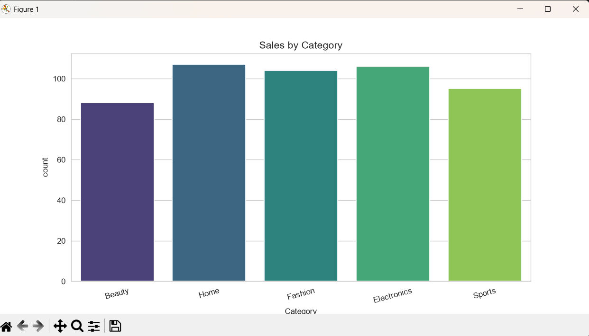
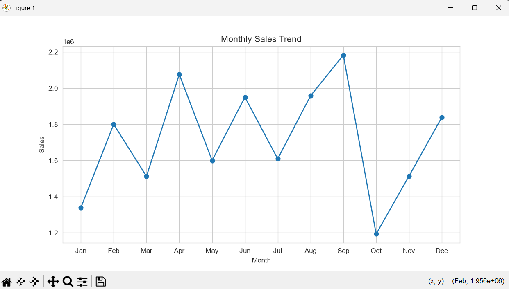
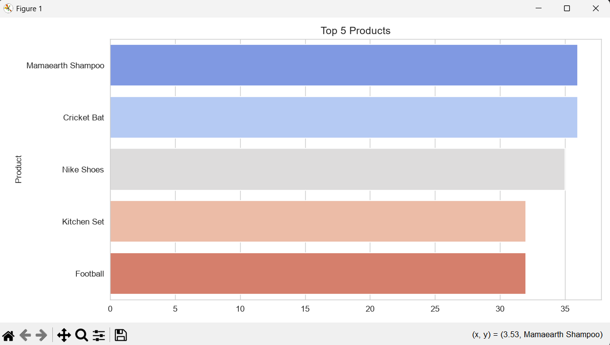

# Ecommerce Sales Analysis - Python
 
## 📌 Overview
Analyzed 500 realistic e-commerce orders to find business insights using Python. Dataset simulates real festive season peak.
 
## 🎯 Business Questions
- Which category sells the most?
- What is the monthly revenue trend?
- Which are the top 5 products?
 
## 🛠️ Tech Stack
Python, Pandas, Matplotlib, Seaborn
 
## 📊 Visualizations & Insights
1. **Sales by Category:** Electronics & Fashion are top (~109 orders each)
2. **Monthly Sales Trend:** September highest (festival season)
3. **Top 5 Products:** Mamaearth, Cricket Bat, Nike Shoes
 

 
## 📁 Files
- `analysis.py` - Python code for EDA
- `Ecommerce_Sales.csv` - 500 rows dataset
 
## ✅ Key Learning
Data Cleaning, Chronological ordering (Jan-Dec), EDA, Data Visualization
